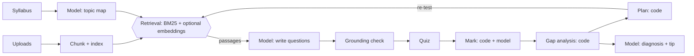

# GapFinder AI

**Find what the student doesn't know.** GapFinder takes a student's syllabus, notes and past papers, tests the student on that material, and produces a diagnosis: which topics are weak, why, and what to revise first in the time available. A chat helper is included, but the main output is the gap report and the plan built from it.

Built for the igebra.ai Hackathon PS 2026 brief ("GapFinder AI").

- **Live app:** https://gapfinder-ai-eta.vercel.app
- **Demo login:** `demo@gapfinder.app` / `demo1234` (also a one-click button on the login page)
- **Fastest tour:** log in as demo, click *Load the sample biology subject*, then follow the five numbered steps.

## The loop

```
Upload  ->  Topic map  ->  Quiz  ->  Gap report  ->  Plan  ->  Re-test  ->  report and plan update
```

| # | Feature in the brief | Where it is |
|---|---|---|
| 1 | Material upload (PDF or text) | **Material** tab. PDFs are read in the browser with pdf.js, so page numbers survive for citations and large files never hit Vercel's 4.5 MB request limit. |
| 2 | Topic map from the syllabus | **Topic map** tab. Topics and subtopics, the passages of the notes filed under each, and how many past-paper questions fall on each. |
| 3 | Diagnostic quiz with citations | **Quiz** tab. One question per retrieved passage; each names its source (file, heading, page). After submitting, the passage is shown with the supporting words highlighted. |
| 4 | Gap report: weak / medium / strong with reasons | **Gap report** tab. Ordered by priority, with the numbers behind each label, a one-line diagnosis of the mistakes, and links to the passages to re-read. |
| 5 | Personalised plan by priority and time | **Plan** tab. "5 days, 2 hours a day" in, day-by-day sessions out. Rebuilt after every quiz, with a "what changed" list. |
| 6 | Explain-this-topic, only from uploads | **Explain a topic** tab. Sources are retrieved and shown first; if nothing relevant is found the model is not called at all. |
| 7 | Progress dashboard | **Progress** tab. Score per quiz, topic status after each quiz, and a topic-by-quiz table. |
| 8 | Login with demo credentials, saved data | Email + password accounts, signed cookie session, everything stored in Postgres. |

## Where retrieval is used, where generation is used, and how they are kept apart

This is the part the brief asks to be explicit about, so it is enforced by the folder structure and not only described.

- **`src/lib/retrieval/`** decides *which passages of the student's material are used*. BM25 keyword ranking written from scratch (`bm25.ts`), optionally blended with embedding similarity (`embeddings.ts`). **It never calls a language model.**
- **`src/lib/generation/`** is the only code that calls a language model (Groq, through the Vercel AI SDK). **It never reads the database.** Every function takes passages as arguments and returns JSON that is validated with zod before anything is saved.
- **`src/lib/analysis/`** is plain arithmetic: scores, weak/medium/strong labels, priorities and the schedule. No model.
- **`src/lib/pipeline.ts`** wires them together in a fixed order: retrieve, then generate from what was retrieved, then verify.

| Step | Retrieval (code) | Generation (model) | Guard |
|---|---|---|---|
| Upload | Split into ~900-character passages that keep file, page and heading. Index for BM25 (and embeddings if enabled). | none | |
| Topic map | File every passage under its best-matching topic and subtopic. Shortlist 3 candidate topics per past-paper question. | Structure the syllabus text into topics. Pick one topic from each shortlist. | The model can only choose from the shortlist or "none". If it is unavailable, the top retrieval match is used. |
| Quiz | Choose topics (every topic first, then weak and exam-heavy ones more) and passages (unused ones first). | Write one question per passage, with a verbatim quote as evidence. | **Grounding check:** if the quote is not in the passage, the question is discarded. The citation is the passage the code chose, never a reference the model wrote. Options are shuffled in code. |
| Marking | Reload the source passage by id. | Mark written answers against the passage, with a reason. MCQs are marked in code. | Verdict reduced to correct / partial / incorrect. Keyword-overlap fallback if the model is down. |
| Gap report | none (inputs are results and past-paper counts) | One sentence per topic on what the wrong answers have in common. | The model never sets a score or a label. |
| Plan | Passages behind missed questions become "re-read" links; mapped past-paper questions become practice. | One study tip per topic. | Minutes and order are computed from priority and time available. |
| Explain | Top passages for the question, sent to the browser before any text is generated. | Answer from those passages only, citing `[1]`, `[2]`. | No relevant passage means no model call and a plain "your material doesn't cover this". |



### How the scores work

- **Mastery** per topic is the recency-weighted share of marks: each older quiz counts half as much as the one after it.
- **Weak** is under 50%, **medium** 50 to 79%, **strong** 80% and above, **not tested** if no question has been answered.
- **Priority** = (1 - mastery) x (0.55 + 0.45 x how often the topic appears in past papers, relative to the most-examined topic). An untested topic counts as 60% unknown.
- **Plan minutes** are shared in proportion to priority. Weak topics with enough time get a second pass later in the plan. Re-test slots are reserved; when time is short the lowest-priority topics are dropped and listed.

## Tech choices

| Choice | Why |
|---|---|
| Next.js 16 (App Router) on Vercel | One deployable for UI and API routes. |
| Vercel AI SDK 7 (`generateText`, `streamText`, `embedMany`) + `@ai-sdk/groq` | As suggested in the brief. |
| Groq `openai/gpt-oss-120b` (main) and `openai/gpt-oss-20b` (light tasks) | Groq removed the Llama 3.x models from the free tier in August 2026; these are its named replacements. Two models also spread the load, since free-tier limits are per model. Both are set by env vars. |
| JSON by prompt + zod validation, one corrective retry | Works on any Groq model, with no dependence on a provider JSON mode. |
| BM25 first, embeddings optional | Exam material is term-heavy, BM25 needs no second API key, and every score can be explained. Set `EMBEDDING_API_KEY` to blend in semantic similarity; if the embeddings call fails the app falls back to BM25. |
| Neon Postgres in production, PGlite locally | Same SQL in both. `npm run dev` needs no database setup. |

## Run locally

Requires Node 22 or newer (the AI SDK 7 minimum).

```bash
npm install
cp .env.example .env.local     # then put your GROQ_API_KEY in it
npm run dev                    # http://localhost:3000
```

Without `DATABASE_URL`, data is stored in `./.data` by an embedded Postgres.

### Test without a Groq key

A rule-based stand-in for the Groq API is included so the whole loop can be exercised offline:

```bash
npm run mock:llm                                   # terminal 1
GROQ_API_KEY=test GROQ_BASE_URL=http://localhost:4010/v1 npm run dev    # terminal 2
npm run test:e2e                                   # terminal 3: 35 checks over HTTP
```

The end-to-end script covers login, upload, topic map, both quizzes, the grounding rejection, the gap report, the plan (fits the time, weak topic first, lists changes), the explain refusal, progress, and access control between users. It also runs against a real key as a smoke test.

## Deploy on Vercel

1. Push this repository to GitHub.
2. In Vercel: **Add New > Project**, import the repository. The Next.js preset needs no changes.
3. Add environment variables: `GROQ_API_KEY` (from console.groq.com) and `AUTH_SECRET` (any long random string).
4. In the project's **Storage** tab, create a **Neon** Postgres database and connect it to the project. That adds `DATABASE_URL`. Tables are created on first request.
5. Redeploy, open the URL, log in as demo.

The app shows a banner if `GROQ_API_KEY`, `DATABASE_URL` or `AUTH_SECRET` is missing.

## Project structure

```
src/
  app/                    pages and API routes
    api/subjects/[id]/    documents, topic-map, quiz, submit, plan, explain
    s/[id]/               materials, topics, quiz, report, plan, explain, progress
    how-it-works/         the retrieval / generation table, in the app
  lib/
    retrieval/            chunk.ts, bm25.ts, embeddings.ts, index.ts   (no model calls)
    generation/           llm.ts, topicMap.ts, paperMapping.ts, quiz.ts, grading.ts, diagnosis.ts, explain.ts
    analysis/             gaps.ts, plan.ts                              (arithmetic only)
    pipeline.ts           the loop: retrieve -> generate -> verify -> save
    db.ts, repo.ts, auth.ts, sample.ts
  components/             client components (uploader, quiz, chat, charts)
scripts/                  mock-llm.mjs, e2e.mjs
```

## Limits and what comes next

- Scanned PDFs without a text layer cannot be read; paste the text instead. OCR is the obvious next step.
- Free Groq limits are tight. A quiz that hits the rate limit is delivered shorter, with a note, instead of failing.
- BM25 misses paraphrases that share no words with the notes; turning on embeddings covers that.
- One question is thin evidence. The report says so when a label rests on a single question.
- Not built yet (listed as future scope in the brief): teacher and class views, parent views, spaced-repetition reminders, LMS integration.
